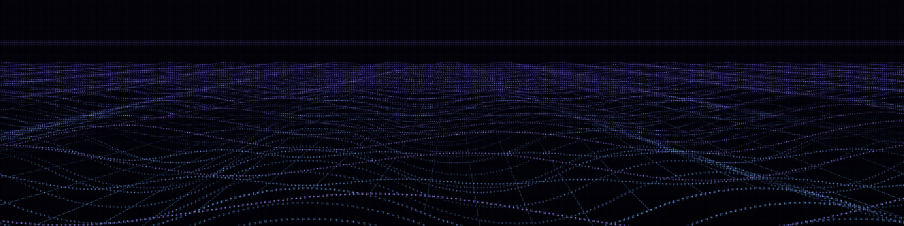

# T3 Code themes

Animated background themes for T3 Code. The theme files in `themes/` are ready to install.

T3 loads at most about 1.9 MB of theme files in total and silently skips the rest (the cap was 196,608 bytes before the 2026-11-15 nightly), so every theme here can be installed at once (the Ghibli themes are ~22 KB each, Nyx · Aurora Ocean ~70-75 KB).

## Nyx

Motion layers on top of the [Nyx theme](https://github.com/Deepusleepy/t3-nyx-theme) by Deepusleepy (MIT, kept in `nyx/base/` with its license). Each one makes the sky breathe and the stars twinkle, adds its own effect, and keeps the background dark enough to read on.

- **Nyx · Aurora Ocean**: a flowing aurora glow and a teal aurora stream over twinkling stars, and a particle ocean along the bottom. The ocean is a dense dotted swell with a cross-hatch mesh, crossed by two seas whose waves come in irregular sets. It comes in three tiers; GPU is Task Manager's figure for T3 Code on a 3440x1440 window with an Intel iGPU (static Nyx: about 2%):

  | Tier | File | What changes | GPU |
  |---|---|---|---|
  | Full | `themes/nyx-aurora-ocean-full.json` | every effect, including flares on the nebula and the glow's hue drift; smooth sky; ocean at full resolution, 24 fps | ~89% |
  | Balanced | `themes/nyx-aurora-ocean.json` | no flares or hue drift; sky at 10 fps; ocean at half resolution, 20 fps | ~43% |
  | Speed | `themes/nyx-aurora-ocean-speed.json` | as Balanced; sky at 8 fps; ocean at 16 fps | ~34% |

  `themes/nyx-aurora-ocean-still-sky.json` (**still sky**) is Balanced with the sky held still and only the ocean moving (~39%).
- `themes/nyx-animated.json` (**Nyx · Aurora Pulse**): the aurora glow pulsing across the whole cloud.
- `themes/nyx-wave-streams.json` (**Nyx · Data Streams**): three neon wave lines flowing along the cloud.

Install one with `t3 theme set themes/<file>.json` (the file name is the theme id).

Source, in `nyx/`:
- `nyx-aurora-ocean.css`, `nyx-common.css`, `variant-*.css`: the motion CSS, appended after the stock Nyx CSS.
- `gen_ocean.py`: generates the ocean, an animated SVG data URI. Its comments explain the wave model and why the rows are drawn the way they are (performance: crisp edges, motion stepped on one shared grid, optionally drawn at reduced resolution and scaled up). `NYX_FPS` and `NYX_RASTER` set its frame rate and resolution; `build.py` sets them per tier.
- `build.py`: rebuilds the Nyx themes into `themes/` (`python -I nyx/build.py`). `build_nyx_animated.py` does the merge and enforces T3's 100,000-character CSS limit (50,000 before late 2026). `step_motion.py` puts the page animations of Aurora Ocean on stepped timing too.
- `glow.css`, `teal-stream.css`: the aurora glow and teal stream images, pre-blurred and recoloured by `tools/bake_glow.mjs` and `tools/bake_teal.mjs` (headless Chrome), so the theme needs no live blur. `full.css` adds the Full tier's extra effects, and `still-sky.css` freezes the sky for the still-sky build.
- `tools/render_ocean.py`: renders the ocean at given times in headless Chrome (`python -I nyx/tools/render_ocean.py nyx/out/variant-ocean.css <absolute out dir> 2 4 6`). `tools/perf.mjs` measures its frame rate (`node nyx/tools/perf.mjs nyx/out/variant-ocean.css 8`). `tools/perf_theme.mjs` measures a whole built theme in a page shaped like T3's layout (`node nyx/tools/perf_theme.mjs themes/nyx-aurora-ocean.json 8`).

## Ghibli pixel art

Personal fan-art themes: each one sets T3 Code's chat background to an animated pixel-art scene from a Studio Ghibli film. Not affiliated with Studio Ghibli; for personal use only.

- `themes/`: the installed theme files (`ghibli-<film>.json`), ready to drop into `~/.t3/userdata/themes/`.
- `scenes/`: the scene source, one Python file per film.
- `build_scene.py <slug> [times...]`: builds a scene, renders preview frames to `out/<slug>/`, writes `theme.json`, and checks the 50,000-character limit and T3's url() rule.
- `install.py <slug>`: writes a built theme into T3's theme folder. `verify.py <slug>` checks the installed copy matches the build.
- `lib.py`: shared pixel-art helpers. `BRIEF.md`: the rules every scene follows.

Status: Spirited Away, Totoro, Ponyo, Kiki, Howl, Nausicaä, Mononoke and Castle in the Sky done; The Boy and the Heron and The Wind Rises paused; Slag Ravine shelved and removed (it's in the git history).
